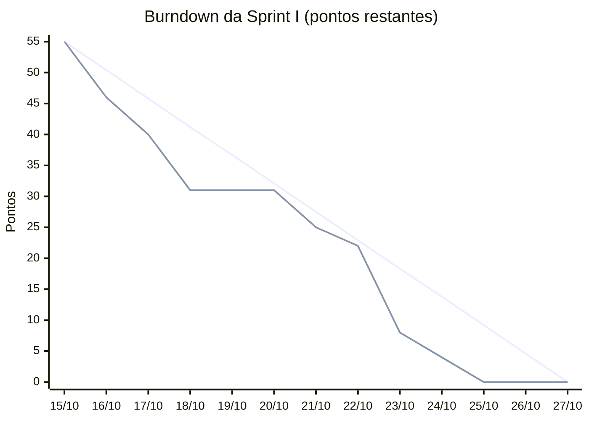

# TermoLOG — Planejamento das Iterações

> Cópia da página [Planejamento das Iterações](https://github.com/ES2-UFPI/TermoLOG/wiki/Planejamento-das-Itera%C3%A7%C3%B5es) da wiki. A wiki é a versão oficial.

## Atalhos

* [Sprint I](https://github.com/ES2-UFPI/TermoLOG/wiki/Planejamento-das-Itera%C3%A7%C3%B5es#sprint---1a-itera%C3%A7%C3%A3o)
* [Sprint II](https://github.com/ES2-UFPI/TermoLOG/wiki/Planejamento-das-Itera%C3%A7%C3%B5es#sprint---2a-itera%C3%A7%C3%A3o)

## Histórico de revisões deste documento

| Data | Versão | Descrição | Autor |
|---|---|---|---|
| 04/10/2026 | 1.0 | Criação do planejamento da Sprint I | Victor Kauan |
| 14/10/2026 | 1.1 | Detalhamento da Sprint I em issues | Victor Kauan |
| 14/10/2026 | 1.2 | Datas da disciplina, estimativa por atividade e pontos das histórias como soma das atividades | Victor Kauan |
| 14/10/2026 | 1.3 | Autenticação incluída na previsão da Sprint II | Victor Kauan |
| 24/10/2026 | 1.4 | Fechamento da Sprint I: release v0.1.0, review, burndown, retrospectiva e avaliação de desempenho | Victor Kauan |

## Estimativas

As atividades foram estimadas em story points na escala de Fibonacci (1, 2, 3, 5, 8, 13), considerando **complexidade**, **incerteza** e **esforço**. A atividade de referência, com 1 ponto, é a [#38](https://github.com/ES2-UFPI/TermoLOG/issues/38). Os pontos de cada história são a soma das suas atividades, e o valor de cada atividade aparece entre parênteses ao lado da issue. O responsável por cada atividade está atribuído na própria issue.

# Sprint - 1a Iteração

## Informações da Sprint

| Descrição | Valor |
|---|---|
| Data de início | 15/10/2026 |
| Data de término | 27/10/2026 |
| Duração (prevista) | 13 dias |
| Líder da Sprint | [Victor Kauan](https://github.com/victor-kauan-coder) |
| Total de pontos planejados | 55 |

**Meta:** cadastrar salas e sensores, definir a faixa de cada sala e acompanhar no painel, em tempo real, a temperatura e a umidade de todas as salas, com destaque para as que estão fora da faixa.

## Papéis

| Papel | Nome |
|---|---|
| Product Owner | [Victor Kauan](https://github.com/victor-kauan-coder) |
| Scrum Master / Líder da Sprint | [Victor Kauan](https://github.com/victor-kauan-coder) |
| Desenvolvedor/Revisor | [Davi Sousa](https://github.com/SoaresDavidson) |
| Desenvolvedor/Revisor | [João Pedro](https://github.com/AthomicalGD) |
| Desenvolvedor/Revisor | [Luanderson Carvalho](https://github.com/luan-crvlh) |
| Desenvolvedor/Revisor | [Victor Kauan](https://github.com/victor-kauan-coder) |

### Planejamento da Sprint I

| História de Usuário | Atividades planejadas na Sprint | Issue(s) | Pontos | Responsável(is) | Finalizada? |
|---|---|---|---:|---|:---:|
| Tarefas técnicas de base | Definir a stack; criar a estrutura do repositório e o padrão de branches; configurar o CI; definir a Definition of Done. | [#49](https://github.com/ES2-UFPI/TermoLOG/issues/49) (1), [#50](https://github.com/ES2-UFPI/TermoLOG/issues/50) (1), [#51](https://github.com/ES2-UFPI/TermoLOG/issues/51) (3), [#52](https://github.com/ES2-UFPI/TermoLOG/issues/52) (1) | 6 | [Davi Sousa](https://github.com/SoaresDavidson), [João Pedro](https://github.com/AthomicalGD), [Victor Kauan](https://github.com/victor-kauan-coder) | ✅ |
| Coleta automática de temperatura e umidade por sala [#1](https://github.com/ES2-UFPI/TermoLOG/issues/1) | Configurar o Docker Compose (FastAPI + PostgreSQL); definir o contrato de envio de leituras; criar a tabela de leituras; criar o endpoint de ingestão em lote; ler o DHT22 no nó de borda; criar o simulador de nó central. | [#27](https://github.com/ES2-UFPI/TermoLOG/issues/27) (5), [#28](https://github.com/ES2-UFPI/TermoLOG/issues/28) (2), [#29](https://github.com/ES2-UFPI/TermoLOG/issues/29) (1), [#30](https://github.com/ES2-UFPI/TermoLOG/issues/30) (3), [#31](https://github.com/ES2-UFPI/TermoLOG/issues/31) (3), [#34](https://github.com/ES2-UFPI/TermoLOG/issues/34) (2) | 16 | [Davi Sousa](https://github.com/SoaresDavidson), [João Pedro](https://github.com/AthomicalGD), [Luanderson Carvalho](https://github.com/luan-crvlh) | ✅ ¹ |
| Identificador único de sensor por sala [#4](https://github.com/ES2-UFPI/TermoLOG/issues/4) | Criar as tabelas de sala e sensor; gerar ID único e não reutilizável; criar os endpoints de salas e sensores; recusar leituras de sensores inválidos; criar o histórico por ID do sensor. | [#35](https://github.com/ES2-UFPI/TermoLOG/issues/35) (2), [#36](https://github.com/ES2-UFPI/TermoLOG/issues/36) (2), [#37](https://github.com/ES2-UFPI/TermoLOG/issues/37) (3), [#38](https://github.com/ES2-UFPI/TermoLOG/issues/38) (1), [#39](https://github.com/ES2-UFPI/TermoLOG/issues/39) (2) | 10 | [Luanderson Carvalho](https://github.com/luan-crvlh) | ✅ |
| Faixas mínima e máxima de temperatura e umidade por sala [#11](https://github.com/ES2-UFPI/TermoLOG/issues/11) | Adicionar as faixas à sala; criar os endpoints de faixa; verificar se a leitura está na faixa; abrir alerta pendente fora da faixa; exibir a faixa no card da sala. | [#40](https://github.com/ES2-UFPI/TermoLOG/issues/40) (1), [#41](https://github.com/ES2-UFPI/TermoLOG/issues/41) (1), [#42](https://github.com/ES2-UFPI/TermoLOG/issues/42) (2), [#43](https://github.com/ES2-UFPI/TermoLOG/issues/43) (3), [#44](https://github.com/ES2-UFPI/TermoLOG/issues/44) (1) | 8 | [João Pedro](https://github.com/AthomicalGD), [Victor Kauan](https://github.com/victor-kauan-coder) | ✅ |
| Registros históricos somente leitura [#25](https://github.com/ES2-UFPI/TermoLOG/issues/25) | Bloquear alteração e exclusão de leituras e alertas no banco. | [#54](https://github.com/ES2-UFPI/TermoLOG/issues/54) (2) | 2 | [João Pedro](https://github.com/AthomicalGD) | ✅ |
| Painel central com status de todas as salas [#9](https://github.com/ES2-UFPI/TermoLOG/issues/9) | Criar o projeto do frontend; criar o endpoint de status das salas; criar a tela do painel com um card por sala; destacar as salas fora da faixa; atualizar o painel automaticamente. | [#53](https://github.com/ES2-UFPI/TermoLOG/issues/53) (3), [#45](https://github.com/ES2-UFPI/TermoLOG/issues/45) (3), [#46](https://github.com/ES2-UFPI/TermoLOG/issues/46) (3), [#47](https://github.com/ES2-UFPI/TermoLOG/issues/47) (2), [#48](https://github.com/ES2-UFPI/TermoLOG/issues/48) (2) | 13 | [Victor Kauan](https://github.com/victor-kauan-coder) | ✅ |

O envio das leituras por LoRa ([#32](https://github.com/ES2-UFPI/TermoLOG/issues/32)) e do nó central para a API ([#33](https://github.com/ES2-UFPI/TermoLOG/issues/33)), com 8 pontos cada, ficou para a Sprint II: são as atividades de maior risco e dependem da definição do nó central. Nesta sprint, o simulador ([#34](https://github.com/ES2-UFPI/TermoLOG/issues/34)) faz esse papel.

¹ As 6 atividades da US01 planejadas para a Sprint I foram concluídas. A história continua aberta porque o envio pela placa ([#32](https://github.com/ES2-UFPI/TermoLOG/issues/32) e [#33](https://github.com/ES2-UFPI/TermoLOG/issues/33)) é da Sprint II.

## Sprint Review

**Release:** [v0.1.0](https://github.com/ES2-UFPI/TermoLOG/releases/tag/v0.1.0), com o merge da `dev` na `main`. As release notes listam as novidades, melhorias e correções.

**Resultado:** 55 de 55 pontos entregues e 26 de 26 atividades fechadas. Toda atividade passou por PR para a `dev`, revisado e aprovado por outro integrante, com o CI verde (ruff, biome, build e testes). A meta da sprint foi cumprida com os dados do simulador; a coleta da placa até a API depende do LoRa, que ficou para a Sprint II.

**Velocidade:** 55 pontos em 13 dias, a referência de capacidade para o Sprint Planning II.

  

### Planejado x entregue

| História | Planejado | Entregue | Situação |
|---|---|---|:---:|
| Tarefas de base | Stack, estrutura do repositório, CI e Definition of Done | Stack no README, padrão de branches `nome#issue`, CI com lint, build e testes em todo PR, pedido automático de revisão e a [Definition of Done](https://github.com/ES2-UFPI/TermoLOG/blob/main/docs/definition-of-done.md) | ✅ |
| US01 [#1](https://github.com/ES2-UFPI/TermoLOG/issues/1) | Ambiente, contrato, tabela e ingestão de leituras, leitura do DHT22 e simulador | Docker Compose com API e PostgreSQL, `POST /gateways/{id}/leituras` com chave de API por gateway, firmware do ESP32 lendo o DHT22 com intervalo configurável e deep sleep, simulador de gateways com seed | ✅ atividades da sprint, história aberta |
| US04 [#4](https://github.com/ES2-UFPI/TermoLOG/issues/4) | Sala e sensor com ID único, recusa de sensor inválido, histórico por sensor | Cadastro de salas e sensores, ID que nunca é reaproveitado, leituras de sensor não cadastrado ou inativo recusadas, `GET /sensores/{id}/leituras` | ✅ aceita |
| US11 [#11](https://github.com/ES2-UFPI/TermoLOG/issues/11) | Faixa por sala, verificação da leitura, alerta pendente e faixa no card | Faixa mínima e máxima de temperatura e umidade, cada leitura marcada dentro ou fora, alerta pendente aberto fora da faixa, faixa no card do painel | ✅ aceita |
| US25 [#25](https://github.com/ES2-UFPI/TermoLOG/issues/25) | Bloquear alteração e exclusão de leituras e alertas | Triggers no PostgreSQL recusam `UPDATE` e `DELETE` em leituras e alertas | ✅ aceita |
| US09 [#9](https://github.com/ES2-UFPI/TermoLOG/issues/9) | Projeto do frontend, status das salas e painel com destaque e atualização automática | Painel web com um card por sala, destaque das salas fora da faixa e atualização a cada 30 s sem recarregar | ✅ aceita |

As histórias foram aceitas pelo PO conforme a DoD, depois de testadas em 24/10 no sistema integrado (API, banco, simulador e painel). A evidência de cada critério está no comentário de aceite da issue.

### Ordem da demonstração (27/10)

1. **Painel ([#9](https://github.com/ES2-UFPI/TermoLOG/issues/9))**: as salas em tempo real, a sala fora da faixa em destaque e a atualização sozinha.
2. **Faixa e alerta ([#11](https://github.com/ES2-UFPI/TermoLOG/issues/11))**: mudar a faixa de uma sala, enviar uma leitura fora dela pelo simulador e ver o destaque e o alerta.
3. **Coleta ([#1](https://github.com/ES2-UFPI/TermoLOG/issues/1))**: o simulador enviando lotes, o DHT22 lido pela placa e a chave de API errada sendo recusada.
4. **Sensor ([#4](https://github.com/ES2-UFPI/TermoLOG/issues/4))**: o cadastro, a recusa de sensor desconhecido e o histórico pelo ID.
5. **Imutabilidade ([#25](https://github.com/ES2-UFPI/TermoLOG/issues/25))**: a tentativa de alterar uma leitura no banco sendo recusada.

### Burndown

Pontos restantes no início de cada dia, pela data de fechamento de cada issue no GitHub. É a mesma conta da coluna "Atual" da planilha de reunião diária (55, 31 e 22 nas reuniões de 15, 20 e 22/10). A linha ideal vai de 55 em 15/10 a 0 em 27/10.

No gráfico, a linha azul é a ideal e a verde é a real.

| Dia | 15/10 | 16/10 | 17/10 | 18/10 | 19/10 | 20/10 | 21/10 | 22/10 | 23/10 | 24/10 | 25/10 | 26/10 | 27/10 |
|---|---|---|---|---|---|---|---|---|---|---|---|---|---|
| Ideal | 55 | 50,4 | 45,8 | 41,2 | 36,7 | 32,1 | 27,5 | 22,9 | 18,3 | 13,8 | 9,2 | 4,6 | 0 |
| Real | 55 | 46 | 40 | 31 | 31 | 31 | 25 | 22 | 8 | 4 | 0 | 0 | 0 |

O real ficou abaixo do ideal a partir do 2º dia. De 18 a 20/10 ficou parado em 31 porque nada fechou no fim de semana; a maior queda foi em 22/10, com a integração da faixa com o painel (7 atividades fechadas no mesmo dia). Todas as atividades estavam fechadas em 24/10.

### Feedback da Sprint Review

A preencher em 27/10 com o feedback do Product Owner (professor) e o que ele muda no Product Backlog.

### Adaptação do Product Backlog

| Mudança | Motivo |
|---|---|
| Os critérios "nos relatórios" da US04 e da US11 e a exportação da US25 passaram para a US10 [#10](https://github.com/ES2-UFPI/TermoLOG/issues/10) | O relatório ainda não existe; cada parte ficou na história que o entrega |
| "Cada alerta mostra o ID do sensor e o nome da sala" entrou na US12 [#12](https://github.com/ES2-UFPI/TermoLOG/issues/12) | O alerta já é gravado com o sensor, mas a lista de alertas na tela é da US12 |
| A US01 continua aberta, com a [#32](https://github.com/ES2-UFPI/TermoLOG/issues/32) e a [#33](https://github.com/ES2-UFPI/TermoLOG/issues/33) na Sprint II | O envio da placa até a API depende do nó central, que ainda não foi definido |

## Retrospectiva da Sprint

### Problemas

- Parte dos commits não citou a issue na mensagem, e alguns PRs não usaram `Closes #N`.
- Alguns critérios de aceite dependiam de outras histórias ("nos relatórios") e foram ajustados no fechamento.
- A escolha do nó central (Raspberry Pi ou ESP32) ficou em aberto e trava a [#32](https://github.com/ES2-UFPI/TermoLOG/issues/32) e a [#33](https://github.com/ES2-UFPI/TermoLOG/issues/33).

### Ações para a Sprint II

- O CI passa a falhar quando um commit do PR não tem `#N` ([#83](https://github.com/ES2-UFPI/TermoLOG/issues/83)), e a regra entrou na Definition of Done.
- Escrever os critérios de aceite só com o que a própria história entrega.
- Decidir o nó central na 1ª reunião da Sprint II.

## Avaliação de Desempenho

O time tem 4 pontos, um por integrante. Todos concluíram as atividades atribuídas e revisaram PRs dos colegas, então a distribuição ficou igual.

| Integrante | Atividades na Sprint I | Pontuação |
|---|---|:---:|
| [Victor Kauan da Silva Miranda](https://github.com/victor-kauan-coder) (líder e PO) | Planejamento da sprint e estimativas; Definition of Done ([#52](https://github.com/ES2-UFPI/TermoLOG/issues/52)); projeto do frontend ([#53](https://github.com/ES2-UFPI/TermoLOG/issues/53)); faixas na sala ([#40](https://github.com/ES2-UFPI/TermoLOG/issues/40)); endpoint de status das salas ([#45](https://github.com/ES2-UFPI/TermoLOG/issues/45)); tela do painel, destaque e atualização automática ([#46](https://github.com/ES2-UFPI/TermoLOG/issues/46), [#47](https://github.com/ES2-UFPI/TermoLOG/issues/47), [#48](https://github.com/ES2-UFPI/TermoLOG/issues/48)); rota `/health` e CORS ([#68](https://github.com/ES2-UFPI/TermoLOG/pull/68)); páginas de arquitetura da wiki; aceite das histórias e release v0.1.0. 15 pontos | 1,0 |
| [João Pedro Saleh de Sousa](https://github.com/AthomicalGD) | Docker Compose ([#27](https://github.com/ES2-UFPI/TermoLOG/issues/27)); estrutura do repositório e padrão de branches ([#50](https://github.com/ES2-UFPI/TermoLOG/issues/50)); ingestão de leituras em lote ([#30](https://github.com/ES2-UFPI/TermoLOG/issues/30)); endpoints de faixa, verificação da leitura, alerta pendente e faixa no card ([#41](https://github.com/ES2-UFPI/TermoLOG/issues/41), [#42](https://github.com/ES2-UFPI/TermoLOG/issues/42), [#43](https://github.com/ES2-UFPI/TermoLOG/issues/43), [#44](https://github.com/ES2-UFPI/TermoLOG/issues/44)); bloqueio de alteração e exclusão ([#54](https://github.com/ES2-UFPI/TermoLOG/issues/54)). 18 pontos | 1,0 |
| [Luanderson Oliveira de Carvalho](https://github.com/luan-crvlh) | Modelos e migrations de sala, sensor e leituras ([#35](https://github.com/ES2-UFPI/TermoLOG/issues/35), [#29](https://github.com/ES2-UFPI/TermoLOG/issues/29)); ID único do sensor ([#36](https://github.com/ES2-UFPI/TermoLOG/issues/36)); endpoints de salas e sensores ([#37](https://github.com/ES2-UFPI/TermoLOG/issues/37)); recusa de sensor inválido ([#38](https://github.com/ES2-UFPI/TermoLOG/issues/38)); histórico por sensor ([#39](https://github.com/ES2-UFPI/TermoLOG/issues/39)); revisão de 10 PRs. 11 pontos | 1,0 |
| [Davi Sousa Soares](https://github.com/SoaresDavidson) | Stack ([#49](https://github.com/ES2-UFPI/TermoLOG/issues/49)); CI ([#51](https://github.com/ES2-UFPI/TermoLOG/issues/51)) e revisão automática ([#58](https://github.com/ES2-UFPI/TermoLOG/pull/58)); contrato de envio de leituras ([#28](https://github.com/ES2-UFPI/TermoLOG/issues/28)) e página Contrato de API; leitura do DHT22 com deep sleep no ESP32 ([#31](https://github.com/ES2-UFPI/TermoLOG/issues/31)); simulador de gateways ([#34](https://github.com/ES2-UFPI/TermoLOG/issues/34)); organização do Project. 11 pontos | 1,0 |
| **Total** | | **4,0** |

# Sprint - 2a Iteração

**Período previsto:** 05/11/2026 a 17/11/2026. O planejamento detalhado, com as issues e as estimativas, será feito no Sprint Planning II. Previsão, na ordem de execução:

| Ordem | Item | Observação |
|:---:|---|---|
| 1 | Login e autenticação no painel [#55](https://github.com/ES2-UFPI/TermoLOG/issues/55) | Login no painel com e-mail e senha, proteção das rotas e chave de API para o nó central enviar leituras. Vem primeiro porque a US12, a US26 e a US10 precisam identificar o usuário |
| 2 | Restante da US01 [#1](https://github.com/ES2-UFPI/TermoLOG/issues/1) | Envio por LoRa ([#32](https://github.com/ES2-UFPI/TermoLOG/issues/32)) e do nó central para a API ([#33](https://github.com/ES2-UFPI/TermoLOG/issues/33)) |
| 3 | Notificação de desvios [#17](https://github.com/ES2-UFPI/TermoLOG/issues/17) | Começar por um canal |
| 4 | Relatório para a vigilância sanitária [#10](https://github.com/ES2-UFPI/TermoLOG/issues/10) | Inclui o responsável técnico identificado pelo login |
| 5 | Reconhecimento de alertas [#12](https://github.com/ES2-UFPI/TermoLOG/issues/12) | Registra qual usuário reconheceu o alerta |
| 6 | Ações corretivas após alertas [#26](https://github.com/ES2-UFPI/TermoLOG/issues/26) | Se houver capacidade; pode ser feita junto com a US12 |

Os perfis de acesso (administrador e visualizador, [#24](https://github.com/ES2-UFPI/TermoLOG/issues/24)) ficam para depois do login, se houver capacidade.
